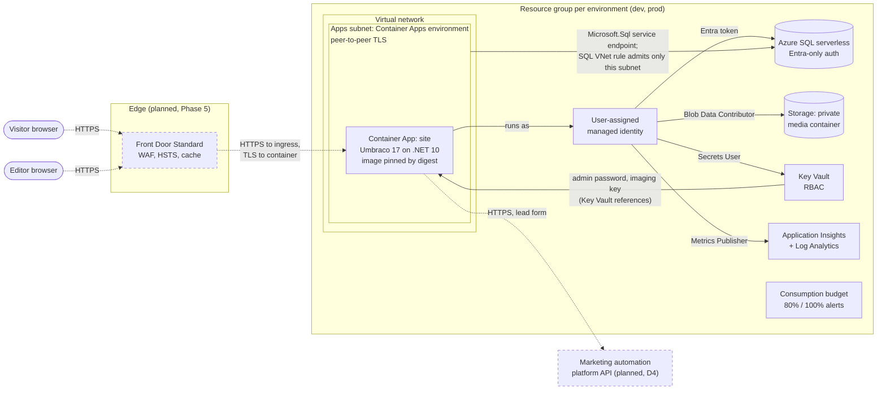
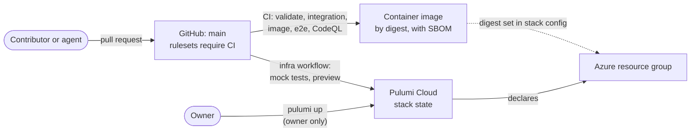

# Architecture

How the deployed site fits together in Azure, per environment. This is the living overview: update it in the same pull request as any change to `infra/` that adds, removes or reconnects a resource. The decisions behind it are in [ADR 0004](adr/ADR-0004-azure-container-apps-hosting.md) and [ADR 0010](adr/ADR-0010-azure-environment-design.md). The trust boundaries for the lead form are in [threat model 0001](threat-models/0001-lead-form.md).

## Runtime view (one environment)

Solid lines are declared in `infra/UmbracoSample.Infra` today. Dashed elements are planned but not declared yet.

Until the edge exists, the Container App's own HTTPS ingress is the entry point, and forms stay off on any public environment (threat model 0001, R2).

## Delivery view

No agent runs `pulumi up` or deploys (CLAUDE.md). Locally, `make run` starts the same site with SQL Server in containers through Aspire (ADR 0002, ADR 0012), with no Azure resources.
